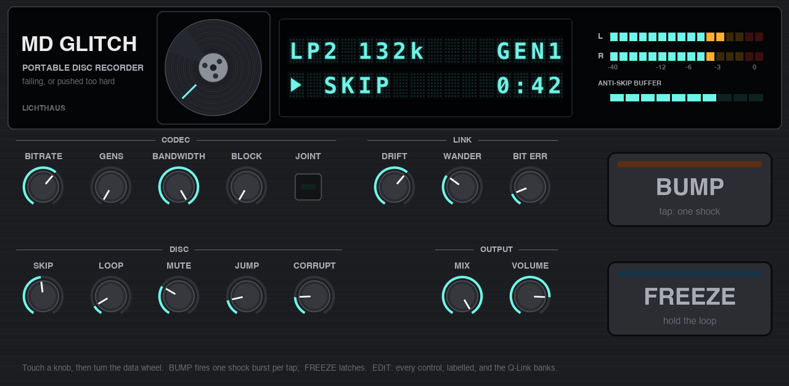

# MD Glitch

An insert effect for Akai MPC standalone that sounds like a portable disc recorder that is failing or
pushed too hard:

- **Codec:** a low-bitrate transform codec (three bands, MDCT, long and short blocks, block floating
  point) with up to eight re-encoding generations. Birdies, pre-echo, watery highs, and a joint-stereo
  mode that starves the sides.
- **Disc:** an anti-skip buffer that stutters, drops out and jumps back. Read errors give chirps and
  noise bursts. BUMP fires one shock and FREEZE holds the loop.
- **Link:** a digital input whose clock doesn't match the source. Sample slips tick, whole-block slips
  click, wander adds a random walk and bit errors flip bits. Below 100% Mix, slips against the dry signal
  give metallic phasing.



VST2 built with Akai's MPC Plugin Builder SDK, for Gen1 (armv7) and Gen2 (aarch64). All DSP is original
code written for this plugin (see [docs/DESIGN.md](docs/DESIGN.md)); there is no third-party code, ROM or
sample data. MIT licence.

**Status: 0.2.5, stable release.**
- Tested on an MPC Live II (Gen1, 0.2.5) and an MPC Key 37 (Gen2, MPC OS 3.10.1.12, 0.2.5).
- On the Live II, 0.2.5 takes about half the CPU of 0.2.4, so every Gens setting is usable. Gens 6-8 add
  enough latency to be felt when playing live (see below).

## Pages

- **PANEL:** a recorder-style front.
  - The display window has a spinning disc and a 2 x 16 display. The display shows mode, bitrate, joint
    stereo, generation and play time, plus the play state: PLAY, SKIP, MUTE, JUMP, HOLD, BUMP!, READ ERR,
    LINK SLIP or STOP.
  - L/R output meters and the anti-skip buffer bar sit beside it.
  - Below are the knobs and big BUMP and FREEZE keys. Touch a knob, then turn the data wheel.
- **EDIT:** every control on one page, in four labelled columns in signal order. Double-tap a knob for the
  big editor.
  - **CODEC:**
    - Bitrate: 24-292 kbps nominal. 292 gives an SP character, 132 LP2 and 66 LP4.
    - Gens: 1-8 re-encodings.
    - Bandwidth: encoder low-pass; Full = off.
    - Block: Auto, Long (most pre-echo) or Short (grainy).
    - Stereo: Dual, or Joint mid-side.
  - **DISC:**
    - Skip: how often and how long the read fails.
    - Loop: stutter and freeze length, shown in ms. One codec frame is 11.6 ms.
    - Mute: the share of dropouts.
    - Jump: the furthest jump back; Off = none.
    - Corrupt: read errors.
  - **LINK:**
    - Drift: receiver clock error in ppm, fine near zero, up to +-2000.
    - Wander: a random walk on the drift.
    - Bit Err: bit flips in the 16-bit words.
  - **OUTPUT:** Mix and Volume.
  - **KEYS:** Bump (each switch-on fires one shock burst) and Freeze (hold-loop).

Q-Links are banked by column:

| Bank | Q-Links |
|---|---|
| 1 | Bitrate, Gens, Bandwidth, Mix |
| 2 | Skip, Loop, Mute, Jump |
| 3 | Drift, Wander, Bit Err, Corrupt |
| 4 | Volume, Block, Stereo, Freeze |

Bump and Freeze are plain parameters, so they can be mapped to pads.

Programs: Clean SP, LP2 Daily, LP4 Watery, Dubbed To Death, Bumpy Bus Ride, Bad Optical Cable, Dying Deck.

## Latency and CPU

Latency is 734 samples (16.6 ms at 44.1 kHz) at one generation, and the plugin reports that figure. Each
extra generation adds 128 samples. From Gens 3, the codec passes are also spread over the host blocks to
keep CPU peaks down, which adds 128 samples at Gens 3-4, 256 at 5-6 and 384 at 7-8. Gens 8 comes to 2014
samples (45.7 ms). The dry path is delayed by the same amount, so Mix never combs. Changing Gens or Stereo
restarts the codec behind a short fade.

The MPC reads a plugin's latency once, when it loads it, so only the Gens 1 figure is compensated. Gens 6-8
(37-46 ms) are best on playback tracks and for resampling. Played live through the insert, they feel a
little late.

Device benches (one plugin alone, one core), as % of a 128-frame block in the heaviest blocks (p99):

| Setting | Key 37 (A76 core) | Live II (A17 core) |
|---|---|---|
| Gens 1 | 1.7% | 4.1% |
| Gens 8 | 3.0% | 7.6% |

Key 37 figures are from 0.2.4. Live II figures are from 0.2.5, the faster Gen1 code (0.2.4 had 7.5% and
13.6% there). The codec's output is bit-identical between the two versions.

Details are in [docs/DESIGN.md](docs/DESIGN.md).

## Install

From the Open MPC catalogue, or by hand: unzip the release for your MPC (`-mpc-aarch64` for Gen2,
`-mpc-armv7` for Gen1). Copy the folder `Lichthaus - VST - MD Glitch` into a folder named `VST2 Plugins`
on an MPC drive. MPC OS 3.10.1 or later needs Preferences > Enhancements (Beta) > Enable Enhancements and
External Plugin Support switched on.

## Build

You need the [MPC Plugin Builder SDK](https://github.com/inmusic-software/mpc-plugin-builder-sdk) (MIT,
inMusic Brands) at `~/dev/mpc-plugin-builder-sdk`, or set `MPC_SDK`, and `uv` for the skin script (Pillow).
`tools/vsthost.cpp` and `tools/qlinktest.cpp` include the SDK's VST2 header from a checkout beside this repo.

```sh
plugin/MDGlitch/make.sh                    # SDK build, skin, SDK build again, host_sim checks
make check                                 # DSP unit and end-to-end tests on the build machine
make && tools/render-all.sh                # test piece and demo renders into renders/
```

`tools/vsthost.cpp` and `tools/qlinktest.cpp` drive the built plugin through its VST2 entry point.
`tools/mdbench.cpp` is the device bench (`make aarch64`, `make arm32`).

## Licence and names

MIT, see [LICENSE](LICENSE). "MiniDisc" and "ATRAC" are Sony trademarks. They are not used in the
plugin's name, skin or screenshots, and no Sony code or documents were used.
